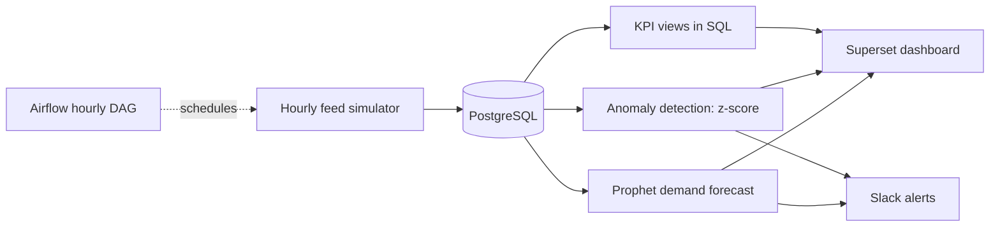

# DA-03: Retail and Supply Chain Control Tower

A near real-time view of inventory, deliveries and suppliers that warns about problems before they hurt sales.

## Architecture

## Features
| Feature | Where |
|---|---|
| Simulated hourly inventory, sales and supplier data | `scripts/generate_data.py`, `scripts/simulate_hourly_feed.py` |
| KPIs: stock-out rate, on-time delivery, supplier lead time, days of inventory | `sql/kpis.sql` |
| Anomaly detection (demand spikes and supplier delays, z-score) | `scripts/detect_anomalies.py`, `scripts/detect_supplier_delays.py` |
| 14-day demand forecast (Prophet) compared with current stock | `scripts/forecast_demand.py` |
| Hourly automation (Airflow DAG) | `dags/hourly_pipeline.py` |
| Slack alerts | `scripts/send_alerts.py` |
| What-if: supplier delayed by N days (0 to 14) | `sql/whatif.sql` |
| Dashboard (8 charts) | Superset |

## Data documentation
| Table | Contents |
|---|---|
| `products`, `stores`, `suppliers` | Reference data (20 products, 5 stores, 6 suppliers) |
| `sales_daily` | 180 days of units sold per store and product |
| `inventory_hourly` | Hourly stock on hand per store and product |
| `deliveries` | 300 shipments with promised and actual dates |
| `demand_anomalies`, `supplier_anomalies` | Flagged demand spikes and supplier delays |
| `demand_forecast`, `stockout_risk` | 14-day forecast and days until stock-out |

## KPI definitions
| KPI | Definition |
|---|---|
| Stock-out rate | % of hourly readings where stock on hand was 0 |
| On-time delivery % | Deliveries on or before the promised date, divided by all deliveries |
| Supplier lead time | Average days from order date to actual delivery date |
| Days of inventory | Latest stock on hand divided by average daily sales of the last 14 days |

## Alert thresholds
Stock risk: CRITICAL if stock lasts 3 days or less, WARNING if 7 days or less. Demand spike: z-score above 5. Supplier delay: z-score above 2.

## What-if analysis
The view `whatif_supplier_delay` simulates a supplier delay of 0 to 14 days for every product. A product is marked STOCK-OUT when the supplier's lead time plus the delay is longer than the days of inventory left. The dashboard table shows the 7-day case, and the line chart "Stock-outs vs supplier delay" shows all delays from 0 to 14. At a 7-day delay, 75 of 100 store-product pairs run out of stock.

## Test results
`pytest tests -v`: 10 passed.

Forecast accuracy (last 14 days held out, 100 store-product series):

| Model | MAE (units/day) | WAPE |
|---|---|---|
| Prophet | 4.43 | 14.7% |
| Baseline (previous 14-day average) | 5.40 | 17.9% |

## Setup (macOS, no Docker)
1. Install Postgres.app (PostgreSQL 16) and run `createdb control_tower`.
2. `python3.11 -m venv venv && source venv/bin/activate`, then `pip install pandas numpy faker psycopg2-binary sqlalchemy prophet pytest`.
3. Run in order: `python scripts/generate_data.py`, `psql control_tower -f sql/schema.sql`, `python scripts/load_data.py`, `psql control_tower -f sql/kpis.sql`, `psql control_tower -f sql/whatif.sql`.
4. Run the analysis: `python scripts/detect_anomalies.py`, `python scripts/detect_supplier_delays.py`, `python scripts/forecast_demand.py`, `python scripts/send_alerts.py`.
5. Airflow (3.1.2) and Superset (6.1.0) each run in their own virtual environment. The DAG calls this project's Python. Set `SLACK_WEBHOOK_URL` in your shell for Slack alerts and never commit it.

## Limitations
The data is simulated, as the assignment allows. Anomaly and forecast tables are rebuilt on every run. The demo runs locally, with no cloud deployment. The dashboard what-if table is fixed at a 7-day delay, with the other delays covered by the line chart and the SQL view.

