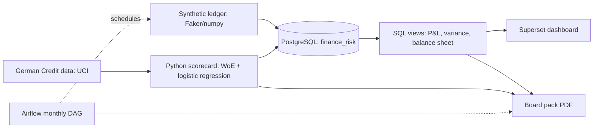
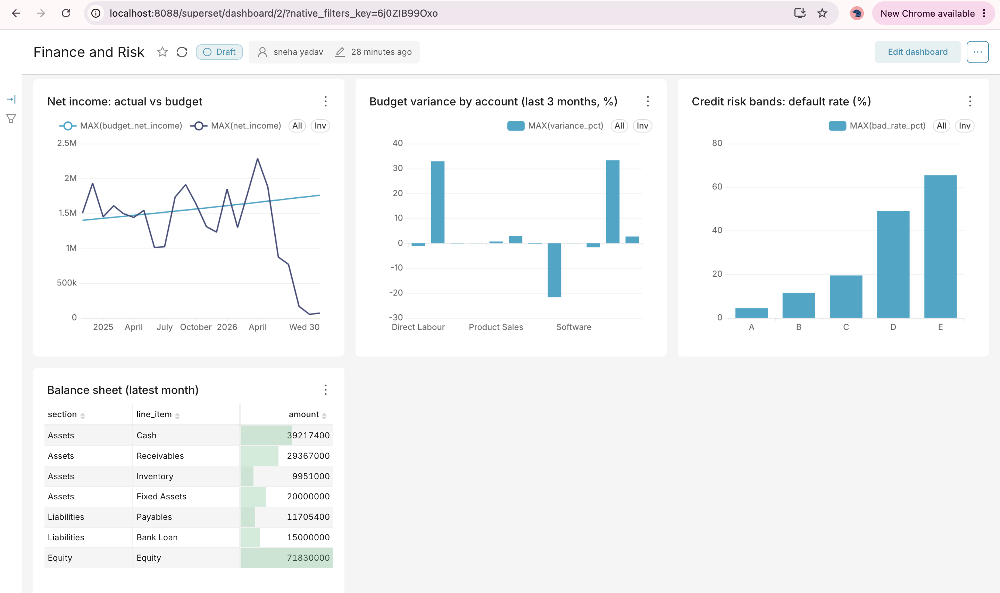
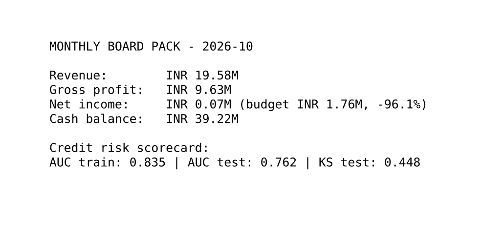
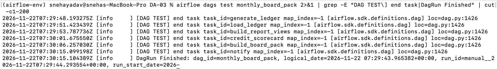

# DA-04: Financial Analytics and Risk Reporting System

Automated finance reports: profit and loss, budget versus actual, balance sheet, credit risk scores, and a monthly board pack (PDF).

## Architecture

## Datasets
| Data | Source |
|---|---|
| Company ledger (24 months of budget and actual by account, plus a monthly balance sheet) | Synthetic, generated in `scripts/generate_ledger.py` (assignment dataset option 7) |
| Credit applicants (1,000 loans, 20 attributes, good/bad outcome) | German Credit (UCI Statlog), downloaded from OpenML and cached in `data/german_credit.csv` |

## What it does
| Requirement | Where |
|---|---|
| P&L and balance sheet summaries (SQL) | `sql/reports.sql` |
| Budget vs actual and variance analysis with drivers | `v_variance_by_account`, dashboard chart "Budget variance by account" |
| Credit risk scorecard (weight of evidence, logistic regression) and risk bands | `scripts/scorecard.py` |
| Interactive dashboard | Superset, "Finance and Risk" |
| Automated refresh and monthly board report (PDF) | `dags/monthly_board_pack.py`, `scripts/board_pack.py` |
| Metric definitions | `docs/metric_definitions.md` |

## Findings from the data
- The ledger is synthetic. Three variances were deliberately planted so the reports have something to find, and the reports surface them: Marketing is about 35% over budget and Travel about 30% over for the last 3 months (unfavorable), and Services revenue is about 20% under budget for the last 4 months (unfavorable).
- The balance sheet balances in every one of the 24 months (assets equal liabilities plus equity), and cash is never negative.
- Credit scorecard: test AUC 0.762 (train 0.835) and test KS 0.448. The default rate rises at every step from risk band A to band E:

| Risk band | Applicants | Default rate | Average score |
|---|---|---|---|
| A (lowest risk) | 200 | 4.5% | 583 |
| B | 200 | 11.5% | 549 |
| C | 200 | 19.5% | 522 |
| D | 200 | 49.0% | 497 |
| E (highest risk) | 200 | 65.5% | 461 |

Scorecard method: the data is split 70/30 into train and test. Features are binned, and each bin gets a weight of evidence. The 12 features with information value of at least 0.05 are used in a logistic regression: checking_status, credit_history, purpose, duration, savings_status, credit_amount, property_magnitude, age, housing, employment, other_parties, other_payment_plans. Scores are scaled so that 600 points equals 50:1 good:bad odds and every 20 points doubles the odds.

## Tool choices (honest note)
The assignment names Advanced Excel (Power Pivot), Qlik Sense and Power Automate. These were not used, because they are Windows or cloud tools that were not available on the macOS development machine. Equivalents used: SQL views instead of Power Pivot, Superset instead of Qlik Sense, and an Airflow monthly DAG instead of Power Automate.

## Screenshots

## Setup (macOS)
1. `createdb finance_risk`
2. Use the same virtual environment as DA-03, and add `pip install scikit-learn`
3. Build the data: `python scripts/generate_ledger.py`, `psql finance_risk -f sql/schema.sql`, `python scripts/load_ledger.py`, `psql finance_risk -f sql/reports.sql`
4. Run the scorecard and the report: `python scripts/scorecard.py`, `python scripts/board_pack.py` (writes a PDF into `reports/`)
5. Tests: `pytest tests -v`
6. Monthly automation: Airflow DAG `monthly_board_pack` (run it from the Airflow environment set up for DA-03, with the DAGs folder set to `DA-04/dags`)

## Test results
`pytest tests -v`: 8 passed. The tests check the row counts, that the balance sheet balances every month, that cash is never negative, that net income equals revenue minus costs, that the planted Marketing and Services variances are flagged unfavorable, that the scorecard AUC on test data is above 0.70, and that there are five risk bands with a rising default rate.

## Limitations
The ledger is simulated, with planted variances to show the analysis. The credit data is small (1,000 loans), so the scorecard metrics are indicative. Risk bands are computed over all 1,000 applicants (train and test), so band default rates are partly in-sample, and the train AUC (0.835) is higher than the test AUC (0.762), which indicates mild overfitting. The board pack is a PDF file written locally and is not emailed. There is no cloud deployment.
